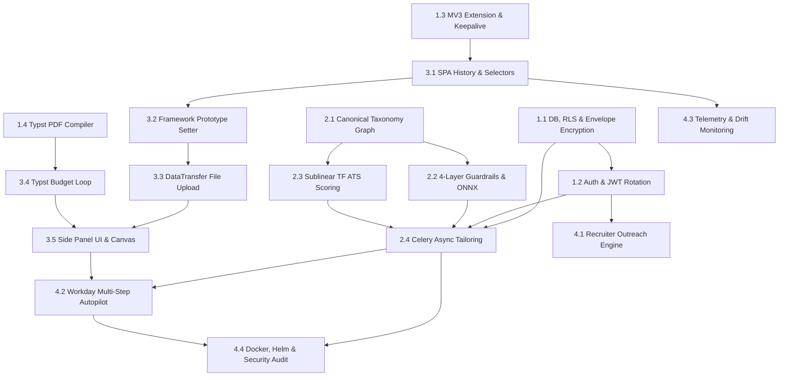

# RoleSync: Comprehensive Production Implementation Plan
## Architecture v2.0 Execution Blueprint: Phase -> Tasks -> Details

---

## Roadmap Overview & Milestone Timeline

```
┌──────────────────────────────────────────────────────────────────────────────────────────────────┐
│                                   ROLESYNC IMPLEMENTATION ROADMAP                                │
├──────────────────────────┬──────────────────────────┬─────────────────────────┬──────────────────┤
│ Phase 1: Core & Storage  │ Phase 2: AI & Guardrails │ Phase 3: DOM & Autofill │ Phase 4: Scale   │
│ (Weeks 1–4)              │ (Weeks 5–8)              │ (Weeks 9–12)            │ (Weeks 13–16)    │
├──────────────────────────┼──────────────────────────┼─────────────────────────┼──────────────────┤
│ • PostgreSQL 16 + RLS    │ • Canonical Taxonomy     │ • SPA History Intercept │ • Outreach Engine│
│ • AES-256 HKDF Envelope  │ • 4-Layer Guardrails     │ • Prototype Setter Hook │ • Workday Wizard │
│ • MV3 Extension + Port   │ • Sublinear Lexical ATS  │ • DataTransfer Uploads  │ • K8s & Helm     │
│ • Typst Binary Compiler  │ • ONNX INT8 NLI Engine   │ • Typst Budget Loop     │ • Security Audit │
└──────────────────────────┴──────────────────────────┴─────────────────────────┴──────────────────┘
```

---

## Phase 1: Core Foundation, Persistence & Client-Extension Scaffolding
**Duration**: Weeks 1–4  
**Primary Goal**: Establish the zero-trust multi-tenant database tier, cryptographic envelope encryption, Manifest V3 extension lifecycle keepalive, and baseline Typst rendering pipeline.

---

### Task 1.1: Database Schemas, Transactional RLS & Envelope Encryption
- **Objective**: Implement PostgreSQL relational tables with kernel-level Row-Level Security (RLS) and HKDF-derived AES-256-GCM column encryption.
- **Details**:
  1. **Alembic Database Migrations**:
     - Define core tables: `users`, `master_profiles`, `jobs`, `applications`, `application_history`, `outreach_emails`, `refresh_tokens`, `usage_tracking`.
     - Create SQL policies for `master_profiles`, `applications`, and `outreach_emails` enforcing `USING (user_id = NULLIF(current_setting('app.current_user_id', true), '')::UUID)`.
  2. **Connection-Pool Safe Session Manager**:
     - Implement `get_tenant_session(user_id)` context manager in SQLAlchemy.
     - Wrap transactions so `SET LOCAL app.current_user_id = :uid` executes on transaction begin and executes `RESET app.current_user_id` upon rollback/commit before releasing the connection back to the pool.
  3. **AES-256-GCM Envelope Encryption Module**:
     - Implement per-tenant key derivation: `DEK = HKDF-SHA256(MasterKey, salt=user_id, info="RoleSync-UserData")`.
     - Implement symmetric encryption/decryption with randomized 96-bit IV and 128-bit authentication tag for `master_profiles.encrypted_profile_data`.
  4. **Qdrant Vector DB Bootstrap**:
     - Initialize `candidate_embeddings` collection (3072 dims, Cosine distance, HNSW `m=16`, `ef_construct=128`).
     - Create mandatory payload keyword index on `user_id`.
- **Target Files**:
  - `backend/app/core/database.py`
  - `backend/app/core/security.py`
  - `backend/app/models/` (SQLAlchemy 2.0 async models)
  - `backend/alembic/versions/001_initial_schema_and_rls.py`
  - `backend/app/services/vector_store.py`
- **Definition of Done**:
  - Unit tests verify that querying without setting `app.current_user_id` returns 0 rows.
  - Test verifying cross-tenant key derivation cannot decrypt another tenant's profile blob.

---

### Task 1.2: Authentication & Token Lifecycle with Rotation (RTR)
- **Objective**: Build Google OAuth2 login flow, short-lived RS256 JWTs, and Redis-backed refresh token rotation.
- **Details**:
  1. **Google OAuth Token Exchange (`POST /api/v1/auth/google`)**:
     - Verify Google ID tokens with Google’s public JWKS.
     - Upsert user record and assign tier (FREE / PRO / ENTERPRISE).
  2. **Dual-Token Engine**:
     - Mint 15-minute RS256 Access Tokens containing claims (`sub`, `email`, `tier`, `exp`, `iss`).
     - Mint high-entropy 30-day Refresh Tokens stored as SHA-256 hashes in Redis, bound to client device fingerprint (`user_agent_hash + extension_instance_id`).
  3. **Refresh Rotation (`POST /api/v1/auth/refresh`)**:
     - Invalidate used refresh token instantly upon exchange; generate and return a new token pair.
     - Detect reuse anomalies: if an invalidated refresh token is presented, revoke all refresh tokens for that user session.
- **Target Files**:
  - `backend/app/api/v1/endpoints/auth.py`
  - `backend/app/services/auth_service.py`
  - `backend/app/core/jwt.py`
- **Definition of Done**:
  - Expired access tokens return 401; refresh endpoint generates new valid JWTs; replay of old refresh tokens triggers full session revocation.

---

### Task 1.3: Chrome Extension (Manifest V3) Base & Keepalive Architecture
- **Objective**: Build the MV3 extension foundation capable of surviving service worker dormancy and communicating securely with the backend.
- **Details**:
  1. **Manifest Configuration (`manifest.json`)**:
     - Configure MV3 permissions: `activeTab`, `storage`, `sidePanel`, `scripting`, `alarms`, `identity`.
     - Restrict `web_accessible_resources` to target ATS host domains to prevent bot fingerprinting.
  2. **Side Panel UI Scaffolding**:
     - Configure Vite + React 18 + TypeScript + Tailwind CSS for `dist/sidepanel/index.html`.
     - Initialize Zustand store synced with `chrome.storage.session`.
  3. **Bidirectional Port Keepalive Manager**:
     - Side panel opens persistent `chrome.runtime.Port` (`rolesync_ui_keepalive`) on launch.
     - Service worker listens for port connections and attaches activity listeners to hold worker context alive during active sessions.
  4. **Web Locks Execution Wrapper**:
     - Implement `KeepaliveManager.executeWithLock(taskId, fn)` utilizing `navigator.locks.request` to prevent background thread termination during critical actions.
- **Target Files**:
  - `extension/manifest.json`
  - `extension/src/background/worker.ts`
  - `extension/src/background/KeepaliveManager.ts`
  - `extension/src/sidepanel/App.tsx`
  - `extension/src/store/useSessionStore.ts`
- **Definition of Done**:
  - Chrome Extension loads unpacked in Developer Mode without warnings.
  - Background worker stays active for >10 minutes while side panel is open without hitting the 30-second dormancy termination.

---

### Task 1.4: Typst PDF Document Engine & Standalone Binary Compiler
- **Objective**: Set up server-side Typst binary execution for vector PDF generation with full syntax escaping.
- **Details**:
  1. **Typst Standalone Compiler Wrapper**:
     - Bundle Typst 0.11+ Linux/macOS standalone binary.
     - Implement isolated execution in Python via `subprocess.run(["typst", "compile", ...])` inside ephemeral temporary directories.
  2. **Exhaustive Syntax Escaper**:
     - Implement `escape_typst(text)` escaping `\`, `"`, `#`, `$`, `_`, `*`, `[`, `]`, `@`, `<`, `>`.
  3. **ATS-Engineered Typst Master Template (`template.typ`)**:
     - Define clean typography using Liberation Sans (open-source Arial/Helvetica equivalent).
     - Standard US-Letter paper format, 0.45in margins, high-density contact headers, dynamic experience bullet blocks.
- **Target Files**:
  - `backend/app/services/typst_compiler.py`
  - `backend/app/templates/template.typ`
  - `backend/tests/test_typst_compiler.py`
- **Definition of Done**:
  - Unit test compiles a full resume payload into PDF bytes in <200ms.
  - Test verifying text containing all special characters (`#`, `$`, `[`, `]`, `@`) compiles without errors.

---

## Phase 2: Semantic Intelligence, Anti-Hallucination & ATS Scoring
**Duration**: Weeks 5–8  
**Primary Goal**: Build the mathematical ATS match scoring engine, canonical skill taxonomy, ONNX INT8 NLI guardrail, and async Celery tailoring pipeline.

---

### Task 2.1: Canonical Skill Graph & Taxonomy Normalizer
- **Objective**: Eliminate false-positive hallucination rejections caused by naming variations (e.g., "Postgres" vs "PostgreSQL").
- **Details**:
  1. **Graph Dictionary Construction**:
     - Create a bidirectional alias graph covering major languages, frameworks, cloud platforms, tools, and databases.
  2. **spaCy Skill Entity Recognizer**:
     - Pipeline utilizing `en_core_web_sm` with custom PhraseMatcher rules for multi-word technical entities ("Amazon Web Services", "Continuous Integration").
  3. **Deterministic Lookup Service**:
     - Normalizes incoming skills to lower-case canonical keys (`normalize_skill(skill_str)`).
- **Target Files**:
  - `backend/app/services/taxonomy.py`
  - `backend/app/data/canonical_skills.json`
  - `backend/tests/test_taxonomy.py`
- **Definition of Done**:
  - `"k8s"` and `"Kubernetes"` map to the same canonical representation.
  - Lookup latency is <0.5ms per skill.

---

### Task 2.2: 4-Layer Anti-Hallucination Guardrail & Quantized ONNX NLI Pipeline
- **Objective**: Mathematically enforce that every claim, metric, and entity on a tailored resume is entailed by the Master Profile.
- **Details**:
  1. **Layer 1: Structural Schema & Layout Constraints**:
     - Validate skill count ($\le 40$), summary length ($\le 600$ chars), bullet count per role.
  2. **Layer 2: Canonical Subset Check**:
     - Assert `normalized_skills ⊆ master_skills`.
     - Assert `company ⊆ master_companies`.
     - Assert `original_bullet_id` maps to an authentic master bullet ID.
  3. **Layer 3: ONNX INT8 Natural Language Inference (NLI)**:
     - Quantize `cross-encoder/nli-deberta-v3-small` or `DeBERTa-v3-large` to ONNX INT8 format.
     - Evaluate Premise (Master bullet) vs Hypothesis (Tailored bullet).
     - Thresholds: Reject if `contradiction > 0.15` or `entailment < 0.88`.
  4. **Layer 4: Unit-Normalized Metric Integrity Check**:
     - Extract quantitative figures using regex.
     - Normalize magnitudes (e.g., `$1.5M` $\rightarrow$ `$1500000`, `1500ms` $\rightarrow$ `1.5s`).
     - Assert `tailored_metrics ⊆ master_metrics`.
- **Target Files**:
  - `backend/app/services/guardrails.py`
  - `backend/models/onnx/nli_quantized.onnx`
  - `backend/tests/test_guardrails.py`
- **Definition of Done**:
  - Unit tests verify 0 false-negatives on injected fabricated skills or altered percentage numbers.
  - ONNX CPU evaluation benchmarks under 80ms per bullet point.

---

### Task 2.3: Sublinear TF & Cosine Composite ATS Scoring Engine
- **Objective**: Implement the mathematically sound 4-dimension composite ATS score, resolving single-document BM25 failure modes.
- **Details**:
  1. **Dimension 1: Cosine Semantic Similarity ($w_1 = 0.35$)**:
     - Generate vector embeddings via `text-embedding-3-large`.
     - Calculate normalized cosine similarity between JD requirements and resume text.
  2. **Dimension 2: Hard Skill Coverage Ratio ($w_2 = 0.30$)**:
     - Calculate recall of canonical required skills against resume skills.
  3. **Dimension 3: Sublinear TF Lexical Matcher ($w_3 = 0.15$)**:
     - Implement $\mathcal{S}_{\text{Lexical}}$ using $(1 + \ln(\text{TF}))$ scaling over significant keywords, avoiding single-doc IDF collapse.
  4. **Dimension 4: Experience Alignment Curve ($w_4 = 0.20$)**:
     - Penalize under-qualification proportionally and apply decay for over-qualification ($> \text{req} + 4$ years).
- **Target Files**:
  - `backend/app/services/scoring_engine.py`
  - `backend/tests/test_scoring_engine.py`
- **Definition of Done**:
  - Lexical score produces smooth, non-zero values across varied real-world test JDs.
  - Edge cases (0 required skills, 0 required years) handled cleanly without division by zero.

---

### Task 2.4: Asynchronous LLM Resume Tailoring & Celery Integration
- **Objective**: Prevent gateway timeouts (504) by offloading tailoring synthesis and guardrail verification to background worker queues.
- **Details**:
  1. **FastAPI Asynchronous Endpoint (`POST /api/v1/tailor`)**:
     - Validates payload, enqueues task in Redis, and returns `202 Accepted` with `task_id`.
  2. **Celery Worker Execution**:
     - Worker extracts Master Profile embeddings and parsed JD.
     - Invokes LLM (LiteLLM with Instructor) at `temperature=0.25` for structured draft extraction.
     - Runs 4-Layer Guardrail with self-correction loop (max 3 retries).
     - Compiles initial Typst PDF.
  3. **WebSocket Progress Channel (`/ws/v1/tasks/{task_id}`)**:
     - Streams real-time task progression: `PARSING` $\rightarrow$ `TAILORING` $\rightarrow$ `VERIFYING` $\rightarrow$ `COMPILING` $\rightarrow$ `COMPLETED`.
- **Target Files**:
  - `backend/app/api/v1/endpoints/tailor.py`
  - `backend/app/tasks/tailor_tasks.py`
  - `backend/app/api/v1/websockets/task_stream.py`
- **Definition of Done**:
  - Tailoring tasks run end-to-end asynchronously without timing out over HTTP.
  - WebSocket delivers state updates to client with low latency.

---

## Phase 3: DOM Interception, Form Automation & Single-Page Budgeting
**Duration**: Weeks 9–12  
**Primary Goal**: Implement client-side SPA navigation listeners, prototype setter hooks for React forms, `DataTransfer` file uploads, and Typst dynamic single-page budget enforcement.

---

### Task 3.1: SPA Dynamic Navigation Interceptor & Tiered Selector Registry
- **Objective**: Maintain active JD parsing across Single Page Applications (Workday, LinkedIn, Lever) without requiring browser reloads.
- **Details**:
  1. **History API Monkeypatching**:
     - Wrap `window.history.pushState` and `window.history.replaceState` in content scripts to dispatch custom `rolesync:location_change` events.
     - Listen for `popstate` and URL modifications.
  2. **Tiered Selector Registry with MutationObserver**:
     - Maintain prioritized selector chains for Greenhouse, Lever, Workday, and LinkedIn.
     - Observer waits for body anchor nodes with an 8-second timeout.
  3. **TreeWalker Generic Fallback**:
     - Text density analysis over candidate DOM nodes when primary selectors fail.
- **Target Files**:
  - `extension/src/content/HistoryInterceptor.ts`
  - `extension/src/content/JobExtractorEngine.ts`
  - `extension/src/content/injector.ts`
- **Definition of Done**:
  - Navigating between jobs on LinkedIn or Workday automatically re-triggers JD extraction without refreshing the page.

---

### Task 3.2: Framework Prototype Interceptors & Gaussian Human Typing
- **Objective**: Prevent React, Angular, and Vue state desynchronization when auto-filling text inputs.
- **Details**:
  1. **Native Prototype Setter Extraction**:
     - Retrieve descriptor from `window.HTMLInputElement.prototype` / `HTMLTextAreaElement.prototype`.
     - Mutate `.value` via `descriptor.set.call(input, value)`.
  2. **Synthetic Event Cascade**:
     - Dispatch `focus`, `keydown`, `keypress`, `input`, `keyup`, `change`, and `blur` events with `bubbles: true`.
  3. **Gaussian Keystroke Jitter**:
     - Character typing delay modeled as a Gaussian random variable ($\mu = 45\text{ms}, \sigma = 15\text{ms}$, clamped $\ge 15\text{ms}$).
- **Target Files**:
  - `extension/src/content/FrameworkAdapter.ts`
  - `extension/src/content/DOMAutofillEngine.ts`
- **Definition of Done**:
  - Automated input into controlled React components retains state upon form submission without reverting to empty strings.

---

### Task 3.3: DataTransfer Binary File Upload & ARIA Combobox Handling
- **Objective**: Programmatically bind compiled Typst PDF files to ATS file upload inputs and interact with modern ARIA listboxes.
- **Details**:
  1. **DataTransfer File Synthesis**:
     - Fetch base64 dataURI of the compiled PDF.
     - Construct a `File` object and append to `DataTransfer.items`.
     - Assign `input.files = dataTransfer.files` and fire `input` and `change` events.
  2. **ARIA Listbox & Combobox Traversal**:
     - Handle Workday/MUI custom select elements: simulate click on container $\rightarrow$ type search query $\rightarrow$ wait for `[role="option"]` $\rightarrow$ synthetic click.
  3. **Radio & Checkbox Automation**:
     - Set checked property via prototype setter followed by native click.
- **Target Files**:
  - `extension/src/content/DOMAutofillEngine.ts`
  - `extension/src/content/FieldResolver.ts`
- **Definition of Done**:
  - Resume PDF attaches successfully to standard file inputs on Greenhouse and Lever test pages.
  - Custom dropdowns select desired option without triggering UI validation errors.

---

### Task 3.4: Typst Single-Page Feedback Budgeting Loop
- **Objective**: Guarantee that generated resumes never overflow into an unintended second page with orphan lines.
- **Details**:
  1. **Page Count Inspection Routine**:
     - Parse PDF output buffer to count page dictionary objects (`/Type /Page`).
  2. **Dynamic Calibration Loop**:
     - If page count $> 1$, iteratively step through typography scale presets:
       - Preset 1: Font `9.5pt`, Spacing `110%`
       - Preset 2: Font `9.0pt`, Spacing `105%`
       - Preset 3: Font `8.5pt`, Spacing `100%`, Margins `0.40in`
     - Recompile and verify until output strictly equals 1 page.
- **Target Files**:
  - `backend/app/services/typst_compiler.py`
  - `backend/tests/test_typst_budget.py`
- **Definition of Done**:
  - Resumes that exceed 1 page under standard styling automatically compact to fit 1 page.

---

### Task 3.5: Side Panel UI & Vector PDF Preview
- **Objective**: Build the user-facing React Side Panel for reviewing tailored changes, match metrics, and PDF previews.
- **Details**:
  1. **Score & Differential Visualizer**:
     - Render radial progress bars for ATS Composite Score and individual sub-scores.
     - Semantic diff view highlighting tailored bullet adjustments.
  2. **In-Panel PDF Canvas Renderer**:
     - Render compiled Typst PDF using `pdfjs-dist` inside an HTML5 canvas.
  3. **1-Click Autofill Trigger & Progress Tracker**:
     - Trigger button to initiate autofill, displaying a real-time progress bar of completed fields.
- **Target Files**:
  - `extension/src/sidepanel/components/ScoreCard.tsx`
  - `extension/src/sidepanel/components/PdfPreview.tsx`
  - `extension/src/sidepanel/components/AutofillProgress.tsx`
- **Definition of Done**:
  - Side Panel renders responsive PDF previews in <500ms from compilation completion.

---

## Phase 4: Third-Party Outreach, Multi-Portal Autopilot & Hardening
**Duration**: Weeks 13–16  
**Primary Goal**: Implement compliant recruiter discovery, Workday multi-step portal traversal, Kubernetes deployment orchestration, and security audits.

---

### Task 4.1: Recruiter Discovery & Verification Engine
- **Objective**: Identify hiring managers and verify email addresses via secure REST APIs without raw port 25 SMTP handshakes.
- **Details**:
  1. **Hunter.io & Apollo REST Integration**:
     - Query hiring manager names extracted from job postings.
  2. **Third-Party Deliverability Validation**:
     - Check email status via ZeroBounce or Hunter verification API (status `valid` and confidence $\ge 80\%$).
  3. **CAN-SPAM & GDPR Compliance Builder**:
     - Draft cold outreach email ($< 120$ words) strictly including physical company address and one-click opt-out link.
- **Target Files**:
  - `backend/app/services/outreach_service.py`
  - `backend/app/api/v1/endpoints/outreach.py`
- **Definition of Done**:
  - Direct port 25 socket handshakes are avoided; verified emails generate compliant outreach drafts.

---

### Task 4.2: Workday Multi-Step Autopilot Engine
- **Objective**: Enable supervised traversal of multi-page ATS wizard workflows.
- **Details**:
  1. **Step Identification State Machine**:
     - Detect current step: `MY_INFORMATION` $\rightarrow$ `MY_EXPERIENCE` $\rightarrow$ `APPLICATION_QUESTIONS` $\rightarrow$ `VOLUNTARY_DISCLOSURES` $\rightarrow$ `REVIEW`.
  2. **Session State Checkpointing**:
     - Commit transition state to `chrome.storage.session` before advancing pages.
  3. **Next-Step Advance & Verification**:
     - Identify and trigger navigation buttons (`Save and Continue`, `Next`); wait for subsequent page DOM initialization.
- **Target Files**:
  - `extension/src/content/WorkdayWizardEngine.ts`
  - `extension/src/content/StatefulTaskRunner.ts`
- **Definition of Done**:
  - System navigates across 3 consecutive pages of a mocked Workday portal, filling inputs on each stage without state loss.

---

### Task 4.3: Telemetry, Error Logging & Selector Drift Monitoring
- **Objective**: Monitor ATS layout mutations and report broken DOM selectors to the backend before widespread user breakage.
- **Details**:
  1. **RFC 7807 Standard Error Payloads**:
     - Format all API errors as `application/problem+json`.
  2. **Selector Drift Telemetry (`POST /api/v1/telemetry/selector-failure`)**:
     - When primary ATS selectors fail on a known host, dispatch telemetry to backend with URL, failed selector, and sanitized page HTML structure.
  3. **Prometheus & Sentry Observability**:
     - Instrument FastAPI middleware with Prometheus metrics (request durations, guardrail rejection rates).
- **Target Files**:
  - `backend/app/core/errors.py`
  - `backend/app/api/v1/endpoints/telemetry.py`
  - `extension/src/content/TelemetryReporter.ts`
- **Definition of Done**:
  - Fallback parsing triggers a background telemetry payload with sanitized metadata.

---

### Task 4.4: Docker Multi-Stage Builds, Kubernetes Helm & Security Audit
- **Objective**: Package the entire system into hardened, production-grade container images and deploy via Kubernetes.
- **Details**:
  1. **Hardened Multi-Stage Dockerfile**:
     - Download and verify Typst standalone binary.
     - Install Python 3.12 dependencies and fonts (`fonts-liberation`).
     - Run container under dedicated non-root user (`appuser`, UID 1000).
  2. **Helm Charts & HPA Configuration**:
     - Kubernetes manifests for FastAPI API pods (HPA 3–15 replicas) and Celery worker pods (HPA 2–10 replicas).
  3. **Penetration & Compliance Audit**:
     - Verify zero SQL injection vulnerabilities in RLS context setting.
     - Validate AES-256 HKDF envelope encryption against OWASP guidelines.
- **Target Files**:
  - `Dockerfile`
  - `docker-compose.yml`
  - `helm/rolesync/values.yaml`
  - `helm/rolesync/templates/`
- **Definition of Done**:
  - Docker container builds cleanly with image size under 350MB and runs unprivileged.
  - Static security analysis (Trivy) reports 0 High/Critical CVEs.

---

## Task Dependency & Execution Sequence



---

## Delivery Gates & Quality Checkpoints

| Gate | Checkpoint Target | Mandatory Verification Criteria |
|:---:|:---|:---|
| **Gate 1** | Week 4: Platform Core | RLS strictly isolates multi-tenant data; Typst renders vector PDF in <200ms; MV3 worker stays active via port keepalive. |
| **Gate 2** | Week 8: Intelligence Tier | 4-layer guardrails yield 0 false negatives on fabricated claims; ONNX CPU inference <80ms; lexical ATS scoring produces non-zero densities. |
| **Gate 3** | Week 12: Client Automation | React controlled inputs update state without resetting; DataTransfer attaches binary PDFs; Typst budget loop compacts multi-page overflow into 1 page. |
| **Gate 4** | Week 16: Production GA | Workday multi-step traversal passes mocked end-to-end tests; non-root Docker build passes Trivy CVE scan with 0 critical issues; Chrome Web Store submission package verified. |

